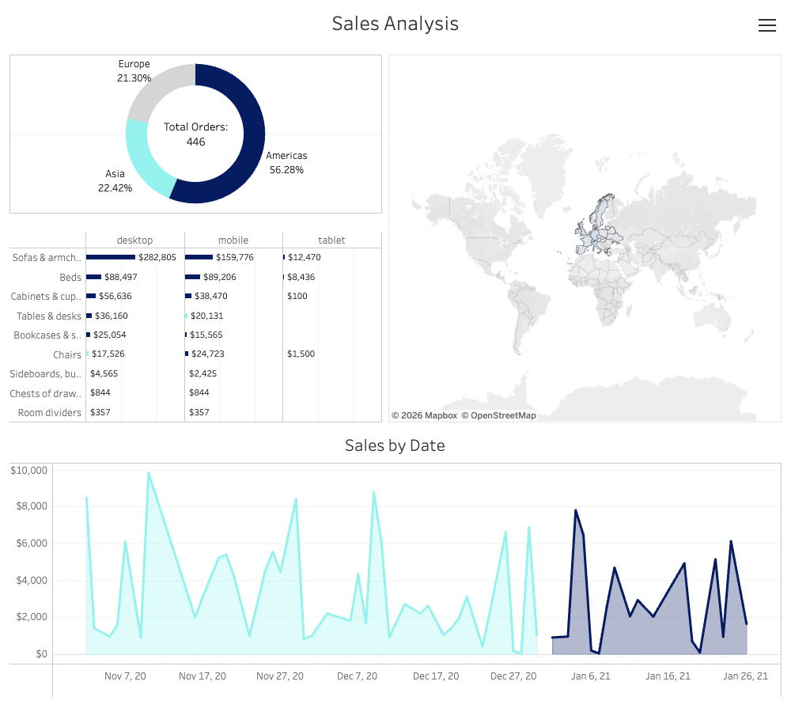
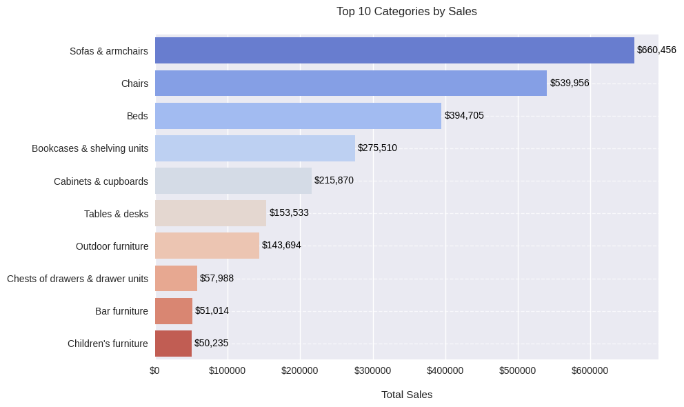
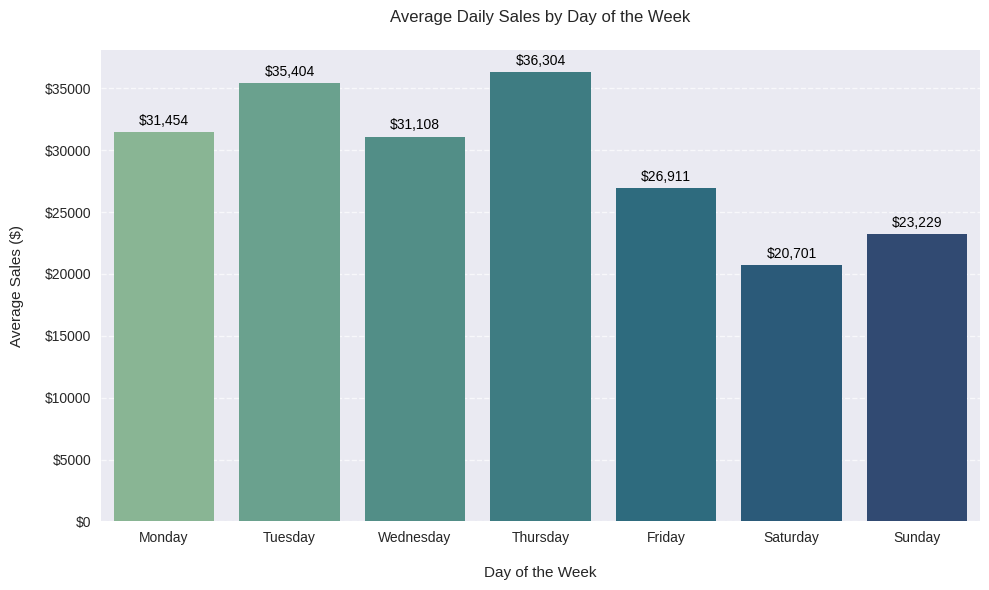

# Online Store Sales Analysis

**End-to-end analysis of an e-commerce furniture store: SQL extraction in BigQuery, exploratory analysis and hypothesis testing in Python, and an interactive Tableau dashboard.**

[](https://public.tableau.com/views/SalesAnalysis_17755718162530/SalesAnalysis)
[](https://colab.research.google.com/github/kasianeno/online-store-sales-analysis/blob/main/online-sales-analysis.ipynb)


[](https://public.tableau.com/views/SalesAnalysis_17755718162530/SalesAnalysis)

## Business questions

1. Where does revenue come from: which regions, channels, devices and customer segments?
2. Which categories and products drive sales, and is that the same everywhere?
3. Are the differences between segments real or noise?

## Key findings

| Area | Finding |
|---|---|
| **Customers** | Subscribed customers generate **83% of revenue** ($2.15M of $2.58M). The gap in daily sales between subscribed and unsubscribed customers is statistically significant (t = 17.5, p < 0.001). 57% of orders come from accounts that are both verified and subscribed. |
| **Channels** | **Organic Search** brings **36% of revenue**, ahead of Paid Search (25%) and Direct (24%). Session volume differs significantly between channels (ANOVA, F = 94.9, p < 0.001). |
| **Geography** | The **Americas** lead, and the **United States** is the largest market. Organic Search drives significantly more sessions in the Americas than in Europe (562 vs 180; t = 12.6, p < 0.001). |
| **Devices** | **Desktop** accounts for **57% of revenue**, mobile for 40%, tablet for 2%. |
| **Products** | *Sofas & armchairs* is the top category. Units and revenue rank differently: **BESTÅ** sells the most units (95), while **GRÖNLID** brings the most revenue among bestsellers ($221K, 8.6% of total). |
| **Timing** | Daily sessions and daily sales move together (Pearson r = 0.80, p < 0.001). Sales drop every weekend: Saturday averages **$20.7K** against **$36.3K** on Thursday. |

<p>
  
  
</p>

## Approach

1. **Data extraction (SQL, BigQuery).** [`data-manipulation.sql`](data-manipulation.sql) joins six tables (sessions, session parameters, accounts, account sessions, orders, products) into one flat table of 2,781 order records with geography, device, traffic channel, account status and product attributes.
2. **Cleaning and EDA (Python).** Type conversion, missing values (33% of `language` is empty) and duplicate checks; breakdowns by continent, country, category, device, operating system, channel and day of the week; pivot tables for channel × device and country × category.
3. **Statistical testing.** Pearson correlation with p-values for sessions vs sales and between regions, channels, categories and products; Shapiro–Wilk normality checks; t-tests and one-way ANOVA for group differences.
4. **Dashboard (Tableau).** Orders by continent, sales by category and device, a map, and daily sales over time, with filters for interactive exploration.

## Repository structure

```
.
├── data-manipulation.sql        # BigQuery query that builds the analysis dataset
└── online-sales-analysis.ipynb  # cleaning, EDA, visualisation and statistical tests
```

The source data comes from a training BigQuery dataset and is not included in the repository.

## Tools

SQL (Google BigQuery) · Python (pandas, NumPy, SciPy, matplotlib, seaborn, Plotly) · Google Colab · Tableau Public

## Limitations and next steps

- Shapiro–Wilk rejected normality for the daily sales series, so the group comparisons should be confirmed with non-parametric tests (Mann–Whitney U, Kruskal–Wallis).
- The analysis works at the level of order records, not unique customers; a customer-level view (repeat purchases, lifetime value) is the natural next step.
- Most pairwise correlations between channels and categories are weak and not significant, so they are reported as context, not as findings.
